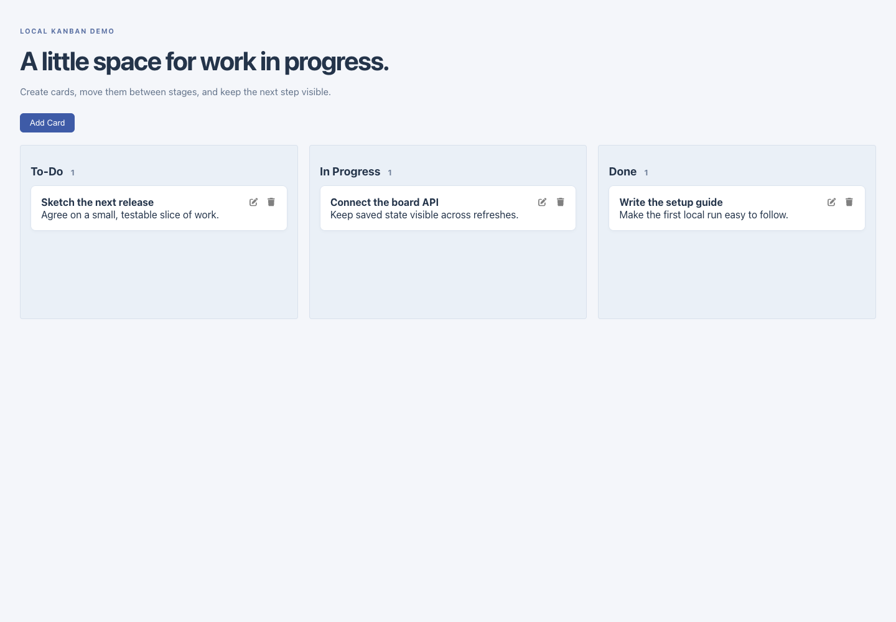
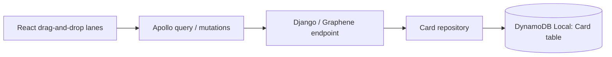

# Mini board

A small React/Apollo task board backed by a Django GraphQL endpoint and DynamoDB Local. Create a card, edit its description, move it between To-Do, In Progress, and Done, or delete it. It is one shared local board, not a multi-tenant project-management service.




## How the parts connect



Moving a card across lanes persists its status. Reordering within one lane is currently local UI state: there is no persisted position field. All clients share the same table and records; there is no implemented account or board ownership boundary.

## Run the local stack

```sh
docker compose up --build
```

The frontend is at localhost:3000, GraphQL at localhost:8001/graphql, and DynamoDB Local at localhost:8000. Published ports bind to loopback. The supplied dummy AWS credentials target the local DynamoDB endpoint; no real AWS account or production credentials are required.

The table setup now checks for an existing `Card` table and leaves it intact, rather than failing each restart by trying to create it again. Docker/DynamoDB readiness and a full browser-to-database round trip were not exercised in this review. Container recreation can discard local DynamoDB state; this Compose file is a development demo, not a persistence/backup plan.

The backend retains its declared Django 3.2-era dependency range. Its copied virtual environment, Python bytecode, and empty SQLite file have been removed. Build from the requirements instead of running an interpreter or dependency copied from another machine. Optional root `.env` settings are shown in [`.env.example`](.env.example): local debug mode can use a generated process-only signing key, while disabled debug mode requires a configured private key.

## GraphQL, without a collection key

```graphql
query {
  allCards { id title description status }
}
```

```graphql
mutation {
  createCard(title: "Synthetic task", description: "Example only", status: "todo") {
    card { id title description status }
  }
}
```

`updateCard(cardId: ..., title: ..., description: ..., status: ...)` updates supplied fields; an empty description can now clear existing text. `deleteCard(cardId: ...)` removes a card. Unknown card lookups return null, and invalid board states are rejected before storage. The old README's token-bearing Postman link is no longer needed for these examples.

## Interface details

Lanes now show actual card counts. Edit/delete controls are keyboard-accessible buttons, modal fields have labels, the modal fits narrow screens, and cancelling an edit clears stale editor state before adding a new card. Card creation updates state immutably, avoiding duplicate inserts under React's development checks. Mutation failures have a visible message, and failed moves request a reload of saved state.

## Checks

From `mini_trello_fe/`:

```sh
npm ci --ignore-scripts
CI=true npm test -- --watchAll=false --runInBand
npm run build
```

From `mini_trello_be/`, with compatible Graphene and boto3 installed:

```sh
python -m unittest discover -s tests -v
```

Two UI tests cover the empty board/form and cancelled-edit reset. Five backend tests cover missing cards, invalid status, clearing descriptions, and existing/missing local table setup using SDK stubs. No real AWS request is made by those tests. The full Django HTTP stack, Docker runtime, live persistence, and drag/mutation concurrency remain unverified.

The API is unauthenticated and its GraphQL view exempts CSRF protection. That fits only the explicit shared local demo. A hosted service needs authentication, per-board authorization, request limits, and stronger operational controls. Table scans currently read one response page; larger boards also need pagination and persisted ordering.

The unreferenced root font folder was removed; the UI's Font Awesome SVG components remain. The credential-like collection key and former development signing-key bytes were removed from reachable branch history, along with committed runtime-environment/database artifacts. If an old credential was used with a real service, revoke it with its owner. A history rewrite cannot erase copies in caches, forks, or other checkouts.
